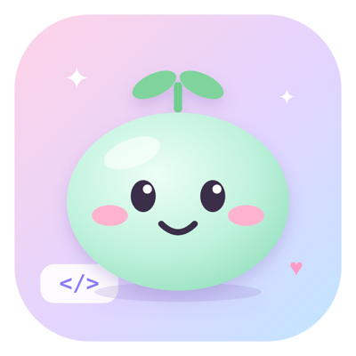
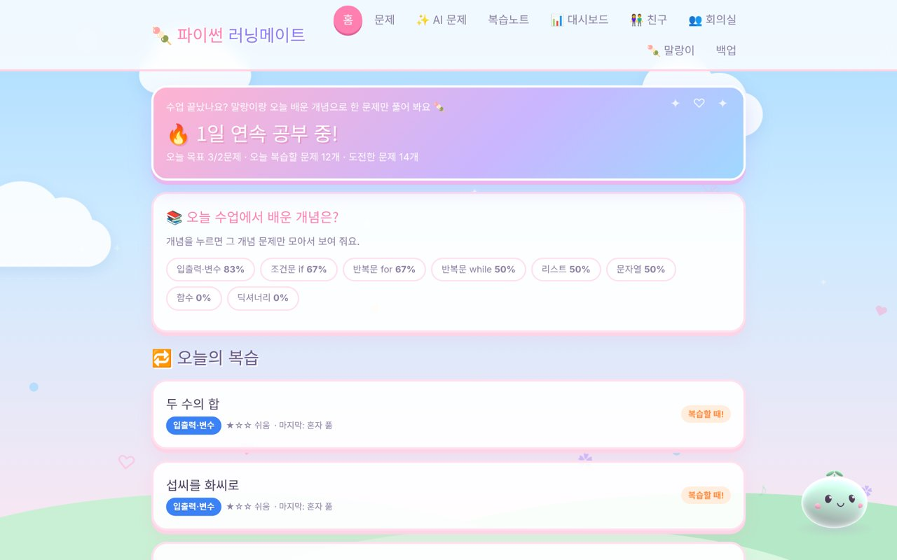
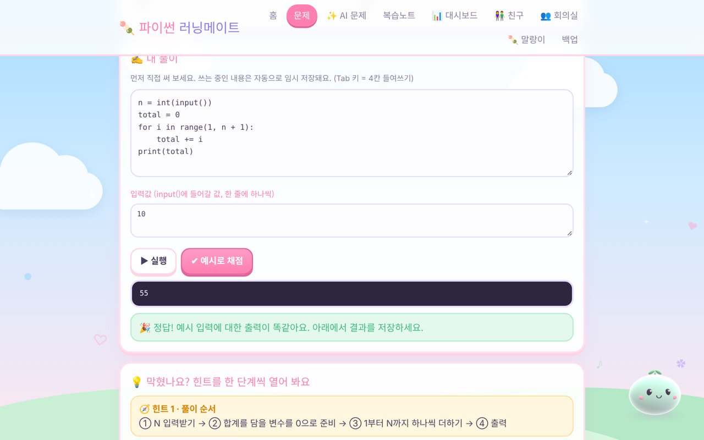
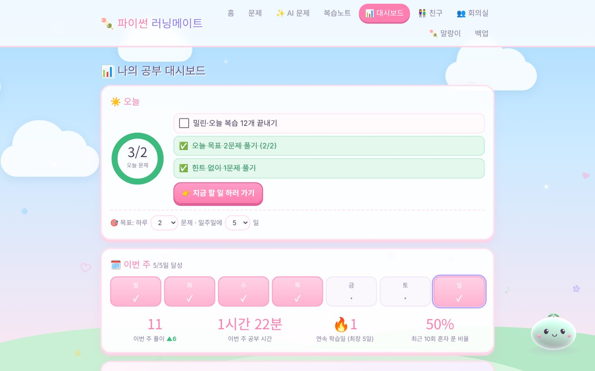
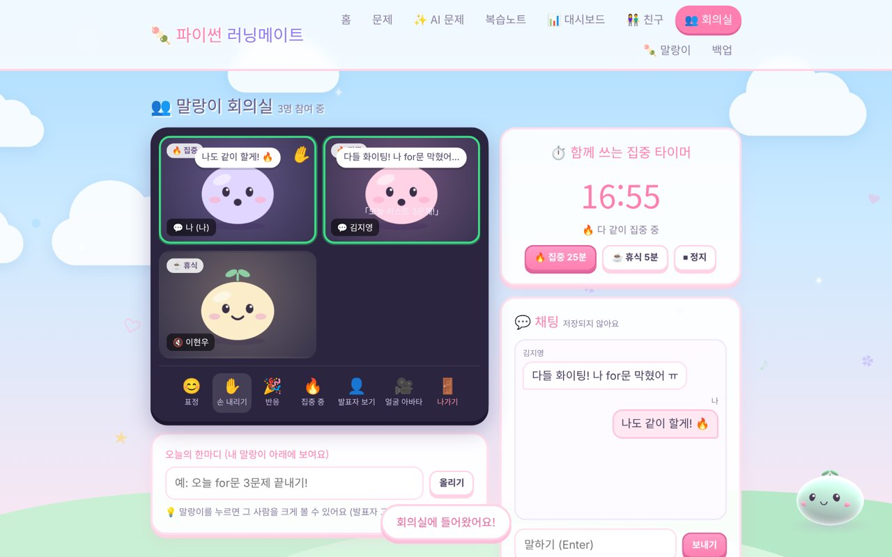

<p align="center"></p>

# 🍡 말랑이 아바타 카메라 · 파이썬 러닝메이트

**정답 대신 푸는 순서를 알려 주는 AI 파이썬 공부 친구**, 「파이썬 러닝메이트」와
그 마스코트 **말랑이**가 내 표정을 따라 하는 아바타 카메라를 담은 저장소예요.

> 컴퓨터공학과 1학년 · AI러닝메이트 프로젝트 결과물

---

## 🎥 말랑이 아바타 카메라

**👉 바로 열기: https://hsj31921219-png.github.io/malang-cam/**

카메라로 내 얼굴 움직임을 읽어서, 3D 말랑이가 그대로 따라 해요.

| 내가 하면 | 말랑이도 |
|---|---|
| 눈 깜빡이기 / 윙크 | 같은 쪽 눈을 깜빡여요 |
| 입 벌리기 | 입을 벌려요 (크게 벌리면 혀까지!) |
| 웃기 | 입꼬리가 올라가고 볼이 빨개져요 |
| 눈썹 올리기 | 눈썹이 올라가요 |
| 고개 돌리기·끄덕이기 | 같이 돌아가요 |

### 사용법
1. 위 주소를 **크롬**으로 열고 **[📷 카메라 켜기]** → 카메라 **허용**
2. 이름표, 배경(파스텔 / 밤하늘 / 초록 크로마키), 몸 색깔을 골라요
3. **[🖥️ 발표 모드]** 를 누르면 말랑이만 크게 보여요
4. Zoom·Google Meet에서 **[화면 공유] → 이 탭**을 고르면 친구들 화면에 말랑이가 나와요

> 💡 회의 프로그램의 카메라는 꺼 두세요. 카메라는 한 프로그램만 쓸 수 있어요.
> 💡 고개가 반대로 돌면 **[좌우 반전]** 을 꺼 보세요.

### 🔒 개인정보
- 얼굴 영상은 **내 컴퓨터 안에서만** 분석하고, 저장하거나 인터넷으로 보내지 않아요.
- 처음 한 번 얼굴 인식 도구(Google MediaPipe)를 인터넷에서 내려받아요.

### 사용한 기술
- **MediaPipe Face Landmarker**: 얼굴 위 점 478개와 표정 값 52개(눈 감음, 입 벌림 등)를 계산
- **three.js**: 도형을 조합해 만든 3D 말랑이 + 말랑하게 찌그러지는 셰이더

---

## 📚 파이썬 러닝메이트 (공부앱)

`app/python-learning-mate.html` 은 공부앱 코드예요 (참고·포트폴리오용).

| 홈 | 문제 풀이 (실행·채점·힌트) |
|---|---|
|  |  |
| **공부 대시보드** | **말랑이 회의실** |
|  |  |

<sub>※ 화면 캡처는 예시 데이터로 찍었어요. 회의실의 참여자 이름도 테스트용이에요.</sub>

| 기능 | 내용 |
|---|---|
| 3단계 힌트 | 풀이 순서 → 쓸 문법 → 코드 뼈대. 모범 풀이는 맨 마지막에 |
| 앱 안 실행·채점 | 브라우저 속 파이썬(Pyodide)으로 바로 실행하고 예시로 채점 |
| AI 문제 무제한 | AI가 만든 정답 코드를 앱이 직접 실행해서 검증 |
| 간격 반복 복습 | 못 푼 문제는 다음 날, 혼자 푼 문제는 3·7·14일 뒤에 다시 |
| 공부 대시보드 | 오늘 할 일, 공부 잔디, 복습 습관, 업적 배지 |
| 친구 · 말랑이 회의실 | 친구 공부현황과 응원, 말랑이 아바타 회의, 함께 쓰는 집중 타이머 |
| 말랑이 힐링 | 꾹꾹 누르며 쉬는 3D 말랑이 + 휴식 타이머 |

> ⚠️ 이 파일을 GitHub에서 직접 열면 **문제 풀이·실행·대시보드**는 되지만,
> **AI 문제 만들기 · 친구 · 회의실**은 claude.ai 안에서 열었을 때만 작동해요.
> 기록은 브라우저(localStorage)에만 저장돼요.

---

## 🛠️ 만든 과정과 AI 활용

이 프로젝트는 AI(Claude)와 함께 만들었어요.
**문제 정의, 기능 선택, 직접 써 보며 버그 찾기, 방향 결정**은 제가 했고,
**코드 작성과 선택지 제안**은 AI가 했어요.

| 부딪힌 문제 | 해결 방법 |
|---|---|
| AI가 만든 문제의 정답이 틀릴 수 있음 | 정답 코드를 앱이 직접 실행해서 검증 |
| 다크 모드에서 드롭다운 글자가 안 보임 | 글자색과 배경색을 직접 지정 |
| 폰에서 앱이 열리지 않음 | 비공개 설정 확인 → 공유 권한으로 해결 |
| 앱 안에서는 카메라·마이크를 쓸 수 없음 | 말랑이 아바타 회의실 + 이 저장소의 아바타 카메라 |
| 원작 캐릭터를 쓰고 싶었음 | 저작권 확인 → 오리지널 마스코트 말랑이 |
| 아바타 카메라를 매번 파일로 열기 귀찮음 | GitHub Pages로 배포 → 앱에서 버튼 한 번 |

말랑이는 이 프로젝트를 위해 만든 **오리지널 캐릭터**예요.

---

## 📁 폴더 구조

```
malang-cam/
├── index.html                      말랑이 아바타 카메라 (GitHub Pages 첫 화면)
├── app/python-learning-mate.html   파이썬 러닝메이트 공부앱
├── docs/screens/                   README용 앱 화면 캡처
├── logo.png                        말랑이 로고
└── README.md
```
